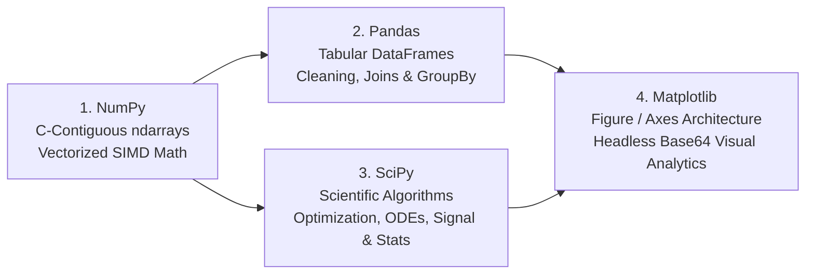

# 🔬 Scientific Python & Data Science Master Documentation Hub

Welcome to the **Teach Cloud Data Science & Scientific Computing Documentation Hub**. This directory houses in-depth, production-grade technical guides for the foundational **PyData Stack (The Big Four)**.

---

## 📚 Master Curriculum Guides

> 💡 **Interactive Architecture:** Each guide below links directly to its live interactive sandbox. Click any guide or manual button to toggle between the full technical manual and the interactive code execution studio.

| Library | Documentation Guide | Key Focus & Architectural Scope | Primary Data Structure |
| :--- | :--- | :--- | :--- |
| **🔷 NumPy** | [`📖 NumPy.md`](NumPy.md) | Contiguous C-memory layouts, SIMD vectorization, strides, broadcasting rules, ufuncs, BLAS linear algebra & `.npy` binary I/O. | `np.ndarray` (Homogeneous N-D buffer) |
| **🐼 Pandas** | [`📖 Pandas.md`](Pandas.md) | Tabular engineering, `.loc` vs `.iloc` explicit indexing, `GroupBy` split-apply-combine, missing data handling, and 85%+ categorical memory optimization. | `pd.DataFrame` & `pd.Series` |
| **🔬 SciPy** | [`📖 SciPy.md`](SciPy.md) | Numerical algorithms, physical constants, CSR/CSC sparse matrices, non-linear `curve_fit`, quadrature (`quad`), ODE solvers (`solve_ivp`), Butterworth filtering & Student's $t$-tests. | Pre-compiled C/Fortran algorithm wrappers |
| **📊 Matplotlib** | [`📖 Matplotlib.md`](Matplotlib.md) | Object-Oriented Figure/Axes architecture, multi-axis analytics dashboards, headless thread-safe web server rendering (`'Agg'`), in-memory Base64 image streams & memory leak prevention. | `Figure` & `Axes` OOP hierarchy |

---

## 🗺️ Architectural Interoperability Pipeline



---

## ⚡ Quick Test Verification

All four libraries and their corresponding web endpoints are backed by automated tests:

```bash
# Execute the full Scientific Stack test suite:
pytest tests/test_numpy_tutorial.py tests/test_pandas_tutorial.py tests/test_scipy_tutorial.py tests/test_matplotlib_tutorial.py tests/test_scientific_stack_routes.py -v
```
